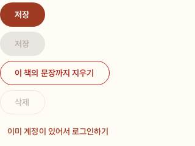
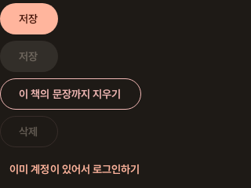
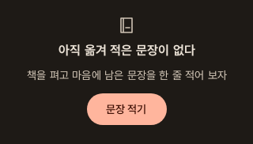
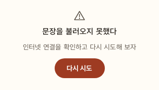
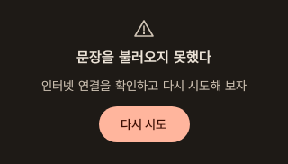
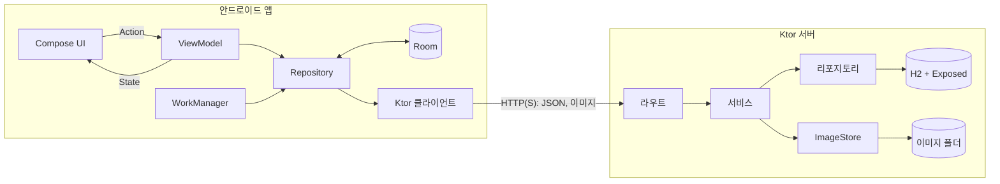
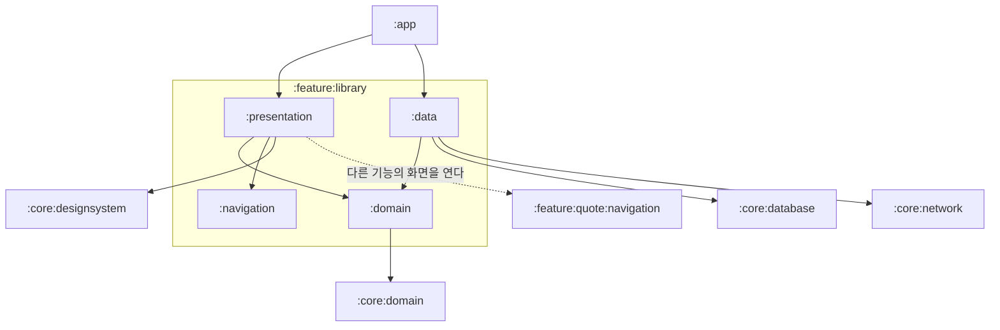
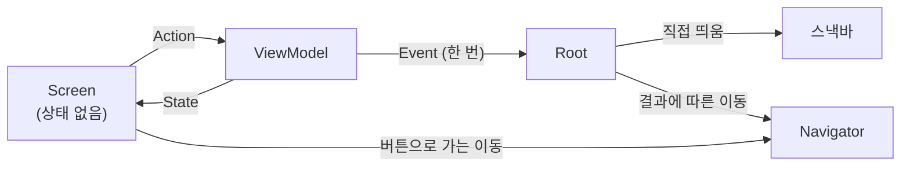
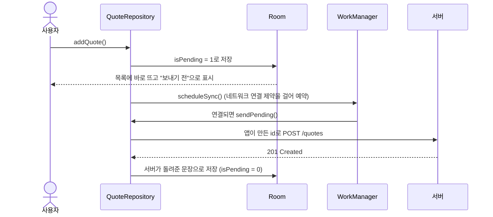
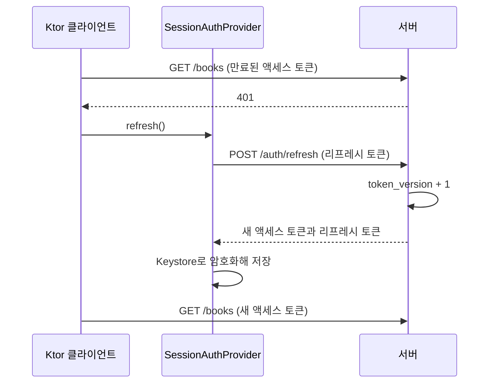

# 밑줄

[](../../actions/workflows/ci.yml)
[](LICENSE)


[English](README.md) · **한국어**

밑줄은 안드로이드용 독서 기록 앱입니다.
읽는 책을 등록하고, 밑줄 그은 문장을 쪽수와 함께 남기고, 한 해 동안 읽은 것을 돌아봅니다.
앱의 기록을 보관하는 Ktor 서버도 직접 만들었고, 앱과 서버가 이 레포 하나에 함께 있습니다.

> [!NOTE]
> 이 프로젝트는 서버 공부를 위해 만든 개인 프로젝트입니다.
> 앱 스토어에 출시하지 않았고, 이슈와 풀 리퀘스트는 받지 않습니다.
> [라이선스](#라이선스) 조건에 따라 자유롭게 읽고, 포크하고, 가져다 쓰셔도 됩니다.

## 기능

- **서재**: 읽고 싶음·읽는 중·다 읽음 세 상태로 책을 나눕니다. 상태는 책을 등록할 때 고르고,
  그 뒤로는 읽은 쪽수에 따라 바뀝니다. 제목이나 지은이로 찾고, 등록순이나 제목순으로 정렬하고,
  표지는 카메라나 갤러리에서 고릅니다.
- **책 상세**: 읽은 쪽수, 1~5점 평점, 짧은 감상을 적습니다.
- **문장**: 문장을 쪽수와 메모와 함께 남깁니다. 책장을 찍으면 온디바이스 OCR로 사진 속 한글을 인식하고,
  그중 고른 문단이 문장 입력란에 들어갑니다. 찍은 사진은 휴대폰 밖으로 나가지 않습니다.
- **문장 카드**: 문장을 이미지로 그려 공유합니다.
- **통계**: 문장을 남기거나 책을 다 읽은 날을 연간 히트맵으로, 다 읽은 책을 월별 막대 차트로,
  그해 다 읽은 책의 쪽수를 합계로 보여 줍니다.
- **오프라인 우선**: 서재는 로컬 DB에서 바로 열리고, 오프라인일 때 남긴 문장은 네트워크가 다시
  연결되면 자동으로 서버에 올라갑니다.
- **계정**: 가입, 로그인, 자동 로그인, 로그아웃. 토큰은 Android Keystore의 키로 암호화해 저장합니다.
- **리마인더**: 매일 정한 시각 무렵에 알림이 옵니다.

## 디자인 시스템

아래 그림은 모두 스크린샷 테스트의 기준 이미지입니다.
CI는 `main`에 푸시할 때마다 컴포넌트를 다시 그려 이 그림과 비교하고, 다르면 실패합니다.

| 밝은 테마 | 어두운 테마 |
| --- | --- |
|  |  |
|  |  |
|  |  |
|  |  |

## 아키텍처

### 한눈에 보기



### 모듈

앱은 기능별로 나누고, 기능 안을 다시 계층별로 나눕니다.
다섯 기능(`auth`·`library`·`quote`·`stats`·`settings`)이 모두 같은 네 모듈을 가집니다.



- `domain`은 모델, 리포지토리 인터페이스, 검증·계산 같은 순수 로직을 둡니다.
  프로젝트 모듈 중에서는 `:core:domain`에만 의존합니다.
- `data`는 그 인터페이스를 기능에 필요한 것(Room·DataStore·WorkManager·Ktor 클라이언트)으로 구현합니다.
- `presentation`에는 화면과 ViewModel이 있습니다.
- `navigation`에는 그 기능의 화면 키와 그 직렬화 설정만 있습니다.
- 기능끼리는 서로 의존하지 않습니다. 하나뿐인 예외가 다른 기능의 `navigation` 모듈입니다.
  서재는 이 길로 문장·통계·설정 화면을 열면서도 그 기능의 코드에는 손대지 못합니다.
- 모든 모듈을 한데 모으는 것은 `:app` 하나입니다. Koin 의존성 그래프와 `NavDisplay`를 여기서 조립합니다.

이렇게 나누는 가장 큰 이유는 기능 사이의 경계를 Gradle이 지켜 주기 때문입니다.
한 기능이 다른 기능에 닿을 수 있는 길은 그 기능의 `navigation` 모듈 하나뿐입니다.
덤으로 한 기능의 내부를 고쳐도 다른 기능은 다시 컴파일되지 않습니다.

서버도 같은 생각으로 나눴습니다.
`server/app`이 전체를 조립하고, `server/core/*`에 도메인·보안·데이터베이스 코드가 있고,
`server/feature/*`는 API 영역마다 모듈 하나입니다.
앱과 서버는 코드를 공유하지 않고, 주고받는 데이터의 모양(DTO)을 양쪽이 각자 선언합니다.

### 화면 하나



화면마다 Root 컴포저블과 Screen 컴포저블이 짝을 이룹니다.
Screen은 `State`를 그리고 사용자 입력을 `Action`이나 콜백으로 올려 보내기만 해서, ViewModel 없이도
프리뷰와 테스트가 됩니다.
저장이 끝난 뒤 돌아가기처럼 결과에 따라 정해지는 이동과 스낵바는 `Event`로 와서 Root가 처리합니다.
버튼을 눌러 다른 화면으로 가는 이동은 ViewModel을 거치지 않고, Screen이 넘겨받은 콜백을 바로 호출해
`Navigator`에 맡깁니다.

### 인터넷이 끊긴 동안 남긴 문장



### 액세스 토큰이 만료되면



## 왜 이렇게 지었나

### Room에서 읽는 화면
서재는 신호가 끊긴 지하철에서도 열려야 합니다.
그래서 화면은 네트워크를 기다리지 않고 로컬 DB를 관찰하고, 새로고침하면 서버에서 받은 내용으로 그 데이터를 바꿉니다.
아직 서버에 못 보낸 문장은 새로고침해도 남깁니다.
새로고침이 끝나기 전까지 잠깐 옛 내용이 보일 수 있지만, 화면이 비는 일은 없습니다.

### 끊긴 동안 쌓아 두는 것은 문장뿐
밖에서 가장 자주 하는 기록이 문장이라, 문장은 기기에 먼저 저장하고 나중에 보냅니다.
책을 등록하거나 고칠 때는 여전히 서버에 먼저 보냅니다.
책의 식별자와 등록 시간은 서버가 붙여 주기 때문입니다.
앱이 식별자를 지어내면, 그 책을 고치거나 지우는 요청이 서버에 없는 책을 가리키게 됩니다.

### 앱이 정하는 문장 id
문장은 쓰는 순간 앱이 UUID를 붙이고, 서버는 그 값을 그대로 기본 키로 씁니다.
타임아웃으로 같은 요청을 재시도해도 서버는 같은 id를 보고 한 번만 저장합니다.
그래서 멱등성 키를 따로 저장할 테이블이 필요 없습니다.

### 예외 대신 `Result`
저장이나 불러오기처럼 한 번 하는 호출은 `Result<T, E>`를 돌려주고, 네트워크와 DB의 실패는 `DataError`로 매핑합니다.
계속 관찰하는 데이터는 `Flow`로 오고, 실패하면 ViewModel이 잡아서 화면 상태에 반영합니다.
`DataError`는 `strings.xml`의 메시지로 바뀌고(드문 에러는 공통 메시지 하나를 같이 씁니다),
서버가 보낸 메시지가 그대로 화면에 노출되는 일은 없습니다.

### denylist 없이 한 번만 쓰는 리프레시 토큰
사용자마다 `token_version`이라는 숫자가 있습니다.
토큰은 발급될 때의 숫자를 담고 있고, 토큰을 갱신하거나 로그아웃할 때마다 그 숫자가 하나 올라갑니다.
그러면 그보다 옛 토큰이 한꺼번에 무효가 되어, 훔친 리프레시 토큰도 주인이 한 번 갱신하는 순간 쓸모가
없어집니다.
대가는 한 기기에서 갱신하거나 로그아웃하면 다른 기기도 로그아웃된다는 것입니다.
혼자 쓰는 서버라 받아들였습니다.

### 동시에 한 번만 일어나는 토큰 갱신
요청 여럿이 한꺼번에 401을 받아도 Ktor의 Bearer 인증 플러그인이 갱신을 한 번만 실행합니다.
그래도 갱신이 끝난 뒤에 401이 늦게 도착할 수 있어서, `SessionAuthProvider`는 만료된 토큰과 저장된 토큰을
한 번 더 비교합니다. 둘이 다르면 이미 갱신된 것으로 보고 저장된 토큰을 그대로 씁니다.
이것이 없으면 늦게 도착한 갱신이 방금 받은 토큰을 무효로 만듭니다.

### 값마다 정해진 보관 위치

| 종류 | 예 | 보관 위치 |
| --- | --- | --- |
| 공개 설정 | 서버 주소 | `local.properties` → `BuildConfig` |
| 사용자 자격 증명 | 액세스·리프레시 토큰 | Android Keystore의 키로 암호화, 백업에서 빠지는 폴더 |
| 서버 시크릿 | 토큰 서명 키 | 서버의 환경변수에만 |

앱 코드에는 서버 주소가 없고, 레포 어디에도 키나 비밀번호가 없습니다.

### 내용으로 확인하는 업로드
파일 이름과 요청에 적힌 형식은 믿지 않습니다.
파일의 앞 몇 바이트가 JPEG나 PNG의 시그니처이고 2MB 이하일 때만 받습니다.

### 서버가 지키는 계정
비밀번호는 Argon2id로 해시해 저장합니다.
가입·로그인 같은 계정 요청과 이미지 업로드에는 IP당 분당 요청 횟수를 제한합니다.

### 앱과 서버가 함께 쓰는 Koin
Koin이 앱과 서버를 똑같이 조립합니다.
코드 생성 없이 순수 코틀린으로 적습니다.

### 어느 휴대폰에서나 같은 모습
폰트(Pretendard·나눔명조)를 앱에 번들하고, 배경화면 색을 따라 앱 색이 바뀌는 다이내믹 컬러는 쓰지 않습니다.
종이와 잉크 같은 색이 이 앱의 일부라, 배경화면이 그 색을 덮으면 안 되기 때문입니다.
화면은 색·크기·간격을 하드코딩하지 않고 `:core:designsystem`의 값을 씁니다.
통계 차트의 비율 몇 개와, 라이브러리의 기본 모양을 그대로 쓰는 오픈소스 라이선스 화면만 예외입니다.

### 토큰·능력·역할 세 층의 디자인 시스템
디자인 토큰은 색·글자·여백·애니메이션 시간처럼 이름을 붙인 값입니다.
능력은 누를 때 일어나는 일 하나만 맡습니다.
`rememberPressScale()`과 `Modifier.pressScale()`은 눌린 동안 살짝 작아지게 하고, `rememberHapticClick()`은 햅틱 피드백을 주는 클릭 핸들러를 만듭니다.
둘은 서로를 몰라서 따로도, 함께도 쓸 수 있습니다.
역할은 능력 몇 개를 미리 묶고 쓰임새로 이름을 붙인 컴포넌트입니다.
`PrimaryActionButton`·`DestructiveActionButton`·`SecondaryActionButton`·`ChoiceChip`·`PressableSurface`가 그렇습니다.
버튼·칩과 누르면 동작하는 목록 한 줄은 이 역할을 쓰고, 능력 함수는 디자인 시스템 밖으로 공개하지 않습니다.
켜고 끄는 행 두 개(리마인더 스위치, OCR 문단 선택 체크박스)만 예외로, `Modifier.toggleable`을 바로 써서
햅틱도 눌림 효과도 없습니다.

버튼에 `haptic = true` 같은 플래그는 두지 않습니다.
플래그가 있으면 햅틱을 켤지 말지를 화면마다 따로 정하게 되고,
카드나 목록 한 줄처럼 버튼이 아닌 것에는 같은 플래그를 또 만들어야 합니다.
대신 `InteractionRole`이라는 enum이 역할마다 어떤 햅틱을 낼지 정합니다.
누르면 동작하는 목록 한 줄도 `PressableSurface` 역할을 쓰므로, 같은 역할이면 어느 화면에서든 같은 반응이 나옵니다.

### 테마에 모아 둔 애니메이션 시간
`AppTheme.motion`에는 버튼이 눌릴 때와 돌아올 때의 시간, 로딩 인디케이터가 나타나기 전에 기다리는 시간,
목록 항목과 통계가 나타나는 시간이 있습니다.
화면은 숫자를 적지 않고 이 값을 읽어 씁니다.
누를 때는 바로 반응하고 뗄 때는 조금 천천히 돌아와야, 실제 물건을 눌렀다 놓는 느낌이 납니다.
로딩 인디케이터는 잠깐 기다렸다 나타나서, 금방 끝나는 로딩에서는 깜빡이지 않습니다.

애니메이션을 끈 사람을 위한 코드는 따로 두지 않습니다.
모든 움직임을 Compose의 애니메이션 함수로 만들어서, 기기 설정의 애니메이션 배율을 Compose가 알아서 따르기 때문입니다.
애니메이션을 끄면 로딩 인디케이터도 기다리지 않고 바로 나타납니다.

눌렸을 때의 크기와 로딩 인디케이터의 투명도는 `graphicsLayer` 블록 안에서 읽습니다.
그래서 애니메이션이 도는 동안 리컴포지션 없이 draw 단계만 다시 실행됩니다.

### 목록에서 상세 화면으로 이어지는 표지
표지 사진이 있는 책을 열면, 서재 목록의 표지가 책 상세 화면의 큰 표지 자리로 옮겨 가며 커집니다(공유 요소 전환).
`:core:navigation`의 `SharedNavTransitions`가 `NavDisplay` 전체를 한 번 감쌉니다.
기능 모듈은 표지의 `Modifier`에 `sharedNavElement(key)`만 붙입니다.
미리보기나 스크린샷 테스트처럼 `SharedNavTransitions`로 감싸지 않은 곳에서는 `sharedNavElement()`가 아무 일도 하지 않습니다.
그래서 화면 코드는 전환이 켜져 있는지 신경 쓰지 않아도 됩니다.

### 컴파일러가 못 잡는 버그를 위한 테스트
로그에 토큰이 새는지, 이유 없이 로그아웃되는지, 같은 화면이 두 번 쌓이는지, 보내기 전 문장이 사라지는지 같은 것들입니다.
로그 마스킹, 토큰 갱신, 화면 이동, 끊긴 동안의 문장 큐, 입력 검증, 통계 계산에 유닛 테스트가 있습니다.
목 라이브러리 대신 실제 인터페이스를 구현한 페이크 객체를 씁니다.

기기에서 도는 계측 테스트는 Room 마이그레이션과, 새로고침해도 보내기 전 문장이 남는 규칙을 봅니다.
서버는 가입·책·문장·이미지 API를 `testApplication`과 인메모리 H2로 엔드투엔드 테스트합니다.
스크린샷 테스트는 디자인 시스템이 의도치 않게 바뀌는 것을 막습니다.

## 시작하기

쓰는 라이브러리와 그 버전은 [`gradle/libs.versions.toml`](gradle/libs.versions.toml)에 모여 있습니다.

### 1. 서버 띄우기

서버는 설정을 환경변수로 받습니다.
꼭 넣어야 하는 것은 `MITJUL_SIGNING_KEY` 하나이고, 나머지는 비워 두면 기본값을 씁니다.

| 환경변수 | 기본값 | 뜻 |
| --- | --- | --- |
| `MITJUL_SIGNING_KEY` | 없음(필수) | JWT 서명 키. 32자 이상의 랜덤 문자열 |
| `MITJUL_HOST` | `127.0.0.1` | 서버가 요청을 받을 IP 주소 |
| `MITJUL_PORT` | `8080` | 서버가 요청을 받을 포트 |
| `MITJUL_DATABASE_URL` | `jdbc:h2:./data/mitjul` | H2 데이터베이스 파일의 위치 |
| `MITJUL_UPLOAD_DIR` | `./data/images` | 올라온 표지 이미지를 저장할 폴더 |

```powershell
.\gradlew :server:app:run
```

이렇게 띄우면 기본값의 `./data`는 `server/app/data`가 됩니다.
키가 없거나 32자보다 짧을 때, 포트가 1~65535 사이의 숫자가 아닐 때는 서버가 시작하지 않습니다.
API 문서는 `http://127.0.0.1:8080/docs`에서 볼 수 있습니다.

### 2. 앱 실행하기

레포 루트의 `local.properties`에 서버 주소 두 줄을 더합니다.
`BASE_URL_STAGING`은 내 컴퓨터에서 띄운 서버를, `BASE_URL_PRODUCTION`은 실제 서버를 가리킵니다.

```properties
BASE_URL_STAGING=http://10.0.2.2:8080/api/v1
BASE_URL_PRODUCTION=https://<실제 서버 주소>/api/v1
```

Build Variants 패널에서 `stagingDebug`를 고르고 `app`을 실행합니다.

### 빌드 베리언트

| 베리언트 | 서버 | 쓰임 |
| --- | --- | --- |
| `stagingDebug` | `BASE_URL_STAGING` | 평소 개발 |
| `stagingRelease` | `BASE_URL_STAGING` | 릴리스 빌드를 다른 것들과 나란히 깔아 확인 |
| `productionDebug` | `BASE_URL_PRODUCTION` | 실제 서버를 보며 디버깅 |
| `productionRelease` | `BASE_URL_PRODUCTION` | 출시할 빌드 |

평문(cleartext) HTTP는 `staging` 쪽에서, 그것도 `10.0.2.2`에만 허락합니다.
베리언트마다 애플리케이션 ID가 달라서 넷 모두 한 기기에 나란히 깔립니다.
릴리스 베리언트 둘은 `keystore.properties`(또는 같은 이름의 환경변수)에 서명 값이 있을 때만 서명됩니다.

## 자주 쓰는 명령

| 명령 | 하는 일 |
| --- | --- |
| `.\gradlew test` | 앱과 서버의 유닛 테스트를 모두 돌립니다 |
| `.\gradlew lintProductionRelease` | 출시할 베리언트를 lint로 검사합니다 |
| `.\gradlew verifyRoborazziDebug` | 컴포넌트를 기준 스크린샷과 비교합니다 |
| `.\gradlew recordRoborazziDebug` | 의도한 UI 변경 뒤 기준 스크린샷을 새로 찍습니다 |
| `.\gradlew :core:database:connectedDebugAndroidTest` | 연결된 기기에서 Room 테스트를 돌립니다 |
| `.\gradlew spotlessApply` | Spotless 규칙대로 코틀린 파일의 형식을 고칩니다 |
| `.\gradlew :server:app:buildFatJar` | 서버를 실행 가능한 jar 하나로 묶습니다 |

CI는 `main`에 푸시할 때마다 `spotlessCheck`·`test`·`lintProductionRelease`·
`verifyRoborazziDebug`를 돌립니다.

## API

아래 엔드포인트는 모두 `/api/v1` 아래에 있습니다.
가입과 로그인에는 토큰이 필요 없고, `/auth/refresh`는 리프레시 토큰을, 나머지는 액세스 토큰을 받습니다.

| 메서드 | 경로 | 하는 일 |
| --- | --- | --- |
| `POST` | `/auth/signup` | 회원가입 |
| `POST` | `/auth/login` | 로그인하고 액세스·리프레시 토큰 받기 |
| `POST` | `/auth/refresh` | 토큰 갱신 |
| `POST` | `/auth/logout` | 로그아웃하고 모든 기기의 토큰 폐기 |
| `GET` `POST` | `/books` | 책 목록 조회(페이지네이션)와 책 등록 |
| `GET` `PUT` `DELETE` | `/books/{id}` | 책 단건 조회·수정·삭제 |
| `GET` `POST` | `/quotes` | 문장 목록 조회(페이지네이션)와 문장 등록 |
| `PUT` `DELETE` | `/quotes/{id}` | 문장 수정·삭제 |
| `POST` | `/images` | 표지 이미지 업로드 |
| `GET` | `/images/{id}` | 표지 이미지 다운로드 |

## 라이선스

[아파치 라이선스 2.0](LICENSE)