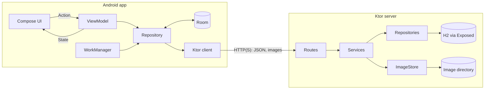
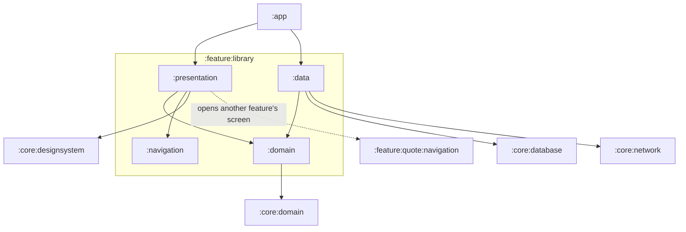
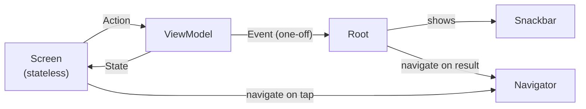
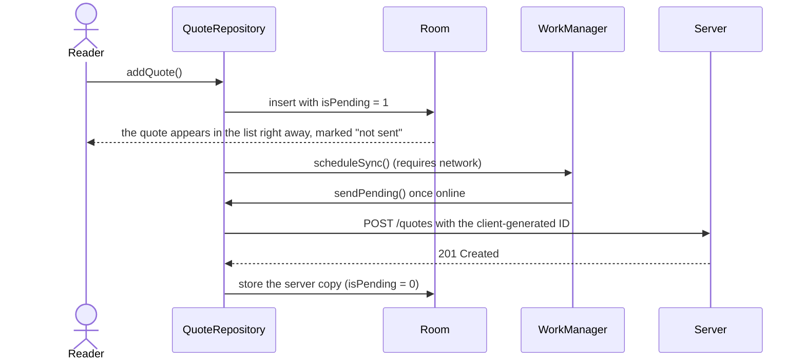
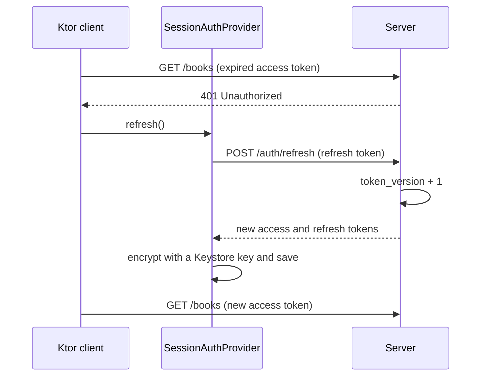

# Mitjul

[](../../actions/workflows/ci.yml)
[](LICENSE)


**English** · [한국어](README.ko.md)

Mitjul (밑줄, Korean for "underline") is a reading journal for Android.
Track the books you read, save the passages you underline along with their page numbers,
and look back on your year in reading.
The app comes with its own Ktor backend, and both live in this repository.

> [!NOTE]
> Mitjul is a personal project I built to learn backend development.
> It is not published on any app store, and this repository does not accept issues or pull requests.
> Feel free to read, fork, and reuse it under the terms of the [license](#license).

## Features

- **Library**: books are grouped as "Want to read", "Reading", or "Finished". You pick the status
  when adding a book; after that it follows the pages read. Search by title or author, sort by
  date added or title, and add a cover photo from the camera or the gallery.
- **Book details**: pages read, a rating from 1 to 5, and a short review.
- **Quotes**: save passages with a page number and a note. Point the camera at a page, and
  on-device OCR detects the Korean paragraphs; the ones you select are inserted into the quote text field.
  The page photo never leaves the device.
- **Quote cards**: render a quote as an image and share it.
- **Stats**: a year-long activity heatmap of the days you saved a quote or finished a book,
  books finished per month, and the total page count of the books finished that year.
- **Offline-first**: the library loads from the local database, and quotes saved offline
  sync automatically once you are back online.
- **Accounts**: sign up, log in, stay logged in, and log out. Tokens are encrypted with a key
  stored in the Android Keystore.
- **Reminders**: a daily notification at about the time you choose.

## Design system

Every image below is a baseline from the screenshot tests.
On every push to `main`, CI renders the components again and fails if any of them differs from these images.

| Light | Dark |
| --- | --- |
|  |  |
|  |  |
|  |  |
|  |  |

## Architecture

### Overview



### Modules

The app is modularized by feature, then by layer.
Each feature (`auth`, `library`, `quote`, `stats`, `settings`) has the same four modules.



- `domain` contains models, repository interfaces, and pure logic such as validation and
  calculations. Among the project's modules, it depends only on `:core:domain`.
- `data` implements those interfaces with whatever the feature needs: Room, DataStore,
  WorkManager, or the Ktor client.
- `presentation` contains the screens and ViewModels.
- `navigation` contains only the feature's route keys and their `SerializersModule`.
- Features never depend on each other, with one exception: a feature may depend on another
  feature's `navigation` module. That is how the library opens the quote, stats, and settings
  screens without touching their code.
- `:app` is the only module that brings everything together. It assembles the Koin graph and the
  `NavDisplay`.

The main reason for this split is that Gradle enforces the boundaries between features: a feature
can reach another feature only through its `navigation` module. A side benefit is that changing
a feature's internals does not trigger a recompile of the other features.

The server follows the same approach: `server/app` assembles everything, `server/core/*` holds the
domain, security, and database code, and `server/feature/*` has one module per API area.
The app and the server share no code; each side defines its own DTOs.

### Screens



Each screen is split into a Root composable and a Screen composable.
The Screen only renders `State` and passes user input up as `Action`s or callbacks, so it can be
previewed and tested without a ViewModel.
Snackbar messages and result-dependent navigation (such as going back after a save) arrive as
one-off `Event`s, which the Root handles.
Navigation triggered directly by a tap skips the ViewModel: the Screen invokes a callback wired
to the `Navigator`.

### Saving a quote offline



### Refreshing an expired access token



## Design decisions

### Screens read from Room
The library has to open even on the subway with no signal.
So screens observe the local database instead of waiting for the network, and a refresh replaces
its contents with what the server returns, except for quotes that have not been sent yet.
The screen may show stale data until a refresh finishes, but it never goes blank.

### Only quotes are queued offline
Jotting down a quote is something people do on the go, so quotes are saved locally first and
synced later.
Adding or editing a book still goes to the server first, because the server assigns the book's
ID and creation time.
If the app made up its own ID, later edits and deletions would point to a book the server does
not know about.

### The app generates quote IDs
A quote gets a UUID when it is created, and the server uses that ID as the primary key.
If a request is retried after a timeout, the server sees the same ID and stores the quote only
once, so there is no need to persist a separate idempotency key.

### Errors are returned as `Result`
One-off calls such as saving or fetching return `Result<T, E>`, with network and database
failures mapped to a `DataError`.
Observed data arrives as a `Flow`; if it fails, the ViewModel catches the error and reflects it in
the screen state.
Every `DataError` maps to a message in `strings.xml` (less common ones share a generic message),
so users never see raw server messages.

### Refresh tokens are single-use, with no denylist
Each user has a counter called `token_version`.
Every token carries the version it was issued with, and each refresh or logout increments it.
That invalidates every older token at once, so a stolen refresh token stops working as soon as
the owner refreshes.
The trade-off: refreshing or logging out on one device logs out every other device.
For a personal server, that is acceptable.

### Concurrent refreshes do not race
When several requests get a 401 at the same time, Ktor's bearer auth plugin runs the refresh only
once.
A 401 can still arrive after that refresh has finished, so `SessionAuthProvider` also compares
the expired token with the stored one; if they differ, the tokens have already been refreshed and
the stored ones are reused.
Without this check, a late refresh would invalidate the tokens that were just issued.

### Each kind of value is stored in one place

| Kind | Example | Where it lives |
| --- | --- | --- |
| Public configuration | Server URL | `local.properties` → `BuildConfig` |
| User credentials | Access and refresh tokens | Encrypted with an Android Keystore key, in a directory excluded from backups |
| Server secrets | Token signing key | Server environment variables only |

No server URL is hard-coded in the app, and no key or password is committed to the repository.

### The server validates uploads by their content
File names and the declared content type are not trusted.
An image is accepted only if its first bytes match a JPEG or PNG signature and it is no larger
than 2 MB.

### Accounts are protected on the server
Passwords are hashed with Argon2id.
The auth endpoints (sign-up, login, refresh, logout) and image uploads are rate-limited per IP
address.

### One dependency injection library on both sides
Koin wires up both the app and the server, in plain Kotlin with no code generation.

### The app looks the same on every phone
The fonts (Pretendard and Nanum Myeongjo) are bundled with the app, and dynamic color is turned off.
The paper-and-ink colors are part of the app, so the wallpaper should not change them.
Screens do not hard-code colors, sizes, or spacing; they use the values defined in
`:core:designsystem`.
The exceptions are a few proportions in the stats charts and the open-source licenses screen,
which keeps the library's default styling.

### The design system has three layers: tokens, capabilities, and roles
Design tokens are named values: colors, type styles, spacing, and animation durations.
A capability adds exactly one behavior to a press.
`rememberPressScale()` with `Modifier.pressScale()` shrinks an element slightly while it is
pressed, and `rememberHapticClick()` builds a click handler that triggers haptic feedback.
Neither knows about the other, so they can be used alone or together.
A role is a component that bundles capabilities and is named after what it is for:
`PrimaryActionButton`, `DestructiveActionButton`, `SecondaryActionButton`, `ChoiceChip`, and
`PressableSurface`.
Buttons, chips, and tappable list rows use a role, and capabilities are internal to the design
system.
The two toggle rows (the reminder switch and the OCR paragraph checkboxes) are the exception:
they use `Modifier.toggleable` directly, with no haptic or press scale.

Buttons have no flags like `haptic = true`.
With flags, every screen would decide for itself whether to vibrate, and anything that is not a
button, such as a card or a list row, would need the same flags all over again.
Instead, an `InteractionRole` enum decides which haptic each role plays.
Tappable list rows use the `PressableSurface` role too, so a role behaves the same on every screen.

### Animation timing lives in the theme
`AppTheme.motion` holds the press and release durations, how long the loading indicator waits
before appearing, and how long list items and stats take to appear.
Screens read those values instead of hard-coding numbers.
The press is quick and the release a little slower, which feels closer to pressing a real object.
The loading indicator waits a moment before it appears, so quick loads do not flash it.

There is no separate code path for users who turn animations off.
Every animation is built with Compose's animation APIs, which follow the system animation scale
on their own.
With animations off, the loading indicator also skips its delay and appears right away.

The press scale and the loading indicator's alpha are read inside a `graphicsLayer` block.
While an animation runs, only the draw phase reruns, with no recomposition.

### Book covers animate from the list into the detail screen
Opening a book that has a cover photo moves the cover from the library list into the large cover
slot on the detail screen, as a shared element transition.
`SharedNavTransitions` in `:core:navigation` wraps the whole `NavDisplay` once.
Feature modules only add `sharedNavElement(key)` to the cover's `Modifier`.
In previews and screenshot tests nothing is wrapped in `SharedNavTransitions`, so
`sharedNavElement()` does nothing there.
Screen code never needs to know whether the transition is on.

### Tests focus on bugs the compiler cannot catch
For example: a token leaking into the logs, being logged out for no reason, the same screen
pushed onto the back stack twice, or a quote lost before it is sent.
Unit tests cover log redaction, token refresh, navigation, the offline queue, validation, and
stats calculations.
They use fakes that implement the real interfaces instead of a mocking library.

Instrumented tests cover the Room migrations and the rule that unsent quotes survive a refresh.
The server's sign-up, book, quote, and image APIs are tested end to end with `testApplication`
and an in-memory H2 database.
Screenshot tests catch unintended changes to the design system.

## Getting started

All libraries and their versions are listed in [`gradle/libs.versions.toml`](gradle/libs.versions.toml).

### 1. Run the server

The server is configured through environment variables.
Only `MITJUL_SIGNING_KEY` is required; the rest fall back to defaults.

| Variable | Default | Purpose |
| --- | --- | --- |
| `MITJUL_SIGNING_KEY` | none (required) | Key for signing auth tokens; a random string of at least 32 characters |
| `MITJUL_HOST` | `127.0.0.1` | IP address the server listens on |
| `MITJUL_PORT` | `8080` | Port the server listens on |
| `MITJUL_DATABASE_URL` | `jdbc:h2:./data/mitjul` | Location of the H2 database file |
| `MITJUL_UPLOAD_DIR` | `./data/images` | Directory for uploaded cover images |

```powershell
.\gradlew :server:app:run
```

Started this way, the default `./data` resolves to `server/app/data`.
The server refuses to start if the key is missing or shorter than 32 characters, or if the port
is not a number between 1 and 65535.
The API docs are served at `http://127.0.0.1:8080/docs`.

### 2. Run the app

Add the two server URLs to `local.properties` in the repository root.
`BASE_URL_STAGING` points at the server running on your machine, and `BASE_URL_PRODUCTION` at
your real server:

```properties
BASE_URL_STAGING=http://10.0.2.2:8080/api/v1
BASE_URL_PRODUCTION=https://<your-server>/api/v1
```

Select the `stagingDebug` variant in the Build Variants panel and run `app`.

### Build variants

| Variant | Server | Purpose |
| --- | --- | --- |
| `stagingDebug` | `BASE_URL_STAGING` | Day-to-day development |
| `stagingRelease` | `BASE_URL_STAGING` | Testing the release build alongside the other variants |
| `productionDebug` | `BASE_URL_PRODUCTION` | Debugging against the production server |
| `productionRelease` | `BASE_URL_PRODUCTION` | The build you would ship |

Cleartext HTTP is allowed only in the `staging` flavor, and only to `10.0.2.2`.
Each variant has its own application ID, so all four can be installed side by side.
The release variants are signed only if the signing properties are present in
`keystore.properties` (or in environment variables with the same names).

## Useful commands

| Command | What it does |
| --- | --- |
| `.\gradlew test` | Runs all unit tests in the app and the server |
| `.\gradlew lintProductionRelease` | Runs lint on the variant you would ship |
| `.\gradlew verifyRoborazziDebug` | Compares components against the baseline screenshots |
| `.\gradlew recordRoborazziDebug` | Records new baselines after an intentional UI change |
| `.\gradlew :core:database:connectedDebugAndroidTest` | Runs the Room tests on a connected device |
| `.\gradlew spotlessApply` | Formats Kotlin files according to the Spotless rules |
| `.\gradlew :server:app:buildFatJar` | Builds the server as a single runnable fat JAR |

CI runs `spotlessCheck`, `test`, `lintProductionRelease`, and `verifyRoborazziDebug`
on every push to `main`.

## API

All paths below are relative to `/api/v1`. Sign-up and login require no token, `/auth/refresh`
takes a refresh token, and all other endpoints require an access token.

| Method | Path | Description |
| --- | --- | --- |
| `POST` | `/auth/signup` | Create an account |
| `POST` | `/auth/login` | Log in and receive access and refresh tokens |
| `POST` | `/auth/refresh` | Exchange a refresh token for a new token pair |
| `POST` | `/auth/logout` | Log out and revoke tokens on all devices |
| `GET` `POST` | `/books` | List books (paginated) or add a book |
| `GET` `PUT` `DELETE` | `/books/{id}` | Get, update, or delete a book |
| `GET` `POST` | `/quotes` | List quotes (paginated) or add a quote |
| `PUT` `DELETE` | `/quotes/{id}` | Update or delete a quote |
| `POST` | `/images` | Upload a cover image |
| `GET` | `/images/{id}` | Download a cover image |

## License

[Apache License 2.0](LICENSE).
